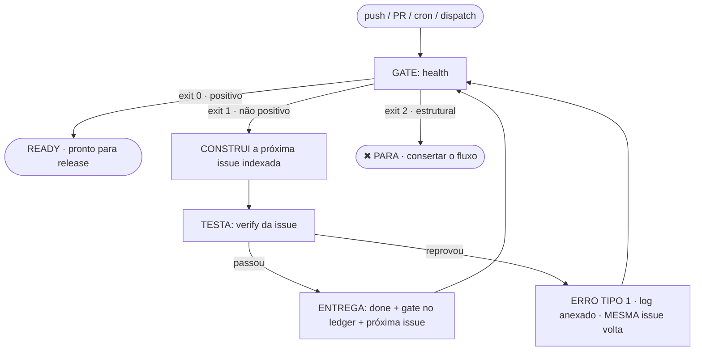
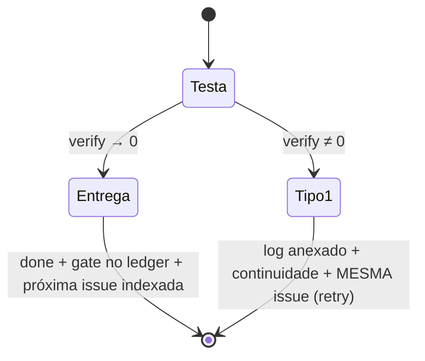

# Pipeline gate-driven — o fluxo issue → teste → próxima issue

> Spec: [`.kiro/specs/18-gate-driven-pipeline.md`](.kiro/specs/18-gate-driven-pipeline.md) · Código: `scripts/pipeline.ts`, `scripts/lib/{result,pipeline-core}.ts` · Gates: [`.github/workflows/pipeline.yml`](.github/workflows/pipeline.yml)
> Tudo aqui foi executado e está nos commits — os trechos de saída abaixo são reais, não ilustrativos.

---

## 1. O blueprint (BPMN) como gates do GitHub Actions



Cada nó é um job/step do workflow; a transição é o **exit code** (o gate), e a
carga entre nós é o **objeto JSON** (o contrato). É gate-driven literalmente:
não há um orquestrador externo decidindo — a decisão está no código de saída.

| Elemento BPMN | Implementação |
|---|---|
| Evento de início | `push`/PR → CI conclui → `workflow_run`; `schedule` diário 07:23 UTC; `workflow_dispatch` |
| Tarefa (gate) | job `gate` → `pipeline health` (issues · CI · testes) |
| Gateway exclusivo | `exit 0` → job `ready`; `exit 1` → job `instruction`; `exit 2` → job vermelho |
| Tarefa de trabalho | job `complete` (dispatch, `stage=complete`) → `pipeline complete T-xxx` |
| Mensagem/artefato | JSON + `next-<id>.md` + `logs/<T>-verify.log` (upload como artifact; commit no `main`) |
| Evento de fim | job `ready` (positivo) ou job vermelho (tipo 2) |

---

## 2. O gatilho de saúde

```bash
npm run pipeline -- health          # JSON no stdout; exit 0/1/2
npm run pipeline -- health --text --emit --record   # resumo, anexos, gate no ledger
```

Verifica a **não-existência** de três coisas — e enquanto qualquer uma existir, o
veredito é `continuity`:

| Verificação | Positivo quando | Fonte |
|---|---|---|
| Issues abertas | nenhuma | GitHub Issues (se habilitado) **ou** as tarefas abertas do roadmap |
| CI com erro | nenhuma execução concluída com `failure`/`timed_out`/`action_required` | `gh run list` da branch |
| Testes | existem arquivos e passam | `npm test` |
| Instrução de teste | toda tarefa aberta tem `verify` | roadmap |

> **Issues desabilitadas neste repositório** (conferido: `has_issues = false`), então os
> work items vêm do roadmap indexado (`T-xxx`). O código consulta `hasIssuesEnabled`
> primeiro: habilitar Issues no GitHub troca a fonte **sem mudar código**.
> Execuções em andamento **não** bloqueiam — um gate que espera o próprio run nunca fecharia.

### Saída real (este repositório, hoje)

```json
{
  "id": "health@2026-10-13T14:31:30.265Z",
  "action": "health",
  "status": "continuity",
  "message": "não positivo — continuação: 13 item(ns) aberto(s) em roadmap: T-308, T-401, T-403 …",
  "attachments": [],
  "nextIssue": { "id": "T-308", "index": 16, "queuePosition": 1, "queueTotal": 13,
                 "verify": "gh workflow run bootstrap-repo.yml && gh run list --workflow=deploy-pages.yml",
                 "acceptance": "`gh workflow run bootstrap-repo.yml && gh run list --workflow=deploy-pages.yml` retorna 0",
                 "actionable": true, "reason": "next" },
  "exitCode": 1
}
```

---

## 3. O contrato: toda ação responde o mesmo objeto

| Campo | Tipo | Papel |
|---|---|---|
| `id` | string | `<ação>@<ISO>` — identifica a execução e nomeia o artefato |
| `action` | string | qual ação rodou (`health`, `next`, `complete T-xxx`) |
| `status` | string | `success` · `continuity` · `error` |
| `errorType` | number? | só em erro: **1** = reprovou (tente de novo) · **2** = estrutural (pare) |
| `message` | string | frase legível; pode vir vazia, pode trazer o log |
| `attachments` | array | **anexos gerados**: `path`, `filename`, `kind`, `bytes` |
| `nextIssue` | objeto? | a seguinte (indexada) em sucesso; a **mesma** (`reason: retry`) em falha |
| `exitCode` | 0/1/2 | é o que o shell e o Actions enxergam — **derivado** do status |
| `at`, `actor` | string | quando e quem (no CI, o ator do GitHub) |
| `details` | objeto | evidências específicas da ação (checks, log tail, continuidade) |

```bash
# o JSON é o contrato e vai sempre no stdout
npm run pipeline -- health > health.json
# resumo legível no stderr + gravação no resumo do Actions
npm run pipeline -- next --text --summary --emit
```

Quem responde este objeto: as três ações do pipeline (`health`, `next`, `complete`) e
**também o agente** quando chamado com `--json` (`npm run agent -- audit --json` devolve o
envelope com `details.payload` — a auditoria completa — e a cabeça da fila em `nextIssue`).

**Exit codes** — 0 sucesso · 1 **erro tipo 1** (verificação reprovou / gate não
positivo: continuidade, com o log e o ponto de retomada) · 2 **erro tipo 2**
(estrutural: entrada inválida, tarefa inexistente, sem instrução de teste,
roadmap ilegível). `exitCode` nunca é digitado à mão: sai de `status`+`errorType`,
então um JSON não consegue dizer `success` com exit não-zero.

---

## 4. O ciclo: cada issue concluída é testada e entregue com a SEGUINTE

```bash
npm run pipeline -- complete T-409          # roda o verify, decide, responde
```



### 4.1 Sucesso — saída real

```json
{
  "action": "complete T-409",
  "status": "success",
  "message": "T-409 testada e entregue (`npm test && npm run lint` → 0) — próxima issue: T-308",
  "attachments": [
    { "path": ".kiro/state/pipeline/logs/T-409-verify.log", "kind": "log", "bytes": 2140 },
    { "path": ".kiro/state/pipeline/next-T-308.md", "filename": "next-T-308.md", "kind": "md" }
  ],
  "nextIssue": { "id": "T-308", "index": 16, "queuePosition": 1, "queueTotal": 13, "reason": "next" },
  "exitCode": 0
}
```

O que ele fez nesse caminho: rodou o `verify` do roadmap → marcou a tarefa `done`
(com evidência) → gravou `task:T-409` como gate **e** um evento no ledger de
continuidade → anexou o log e o briefing da próxima issue.

### 4.2 Falha de verificação — erro tipo 1 (real, pego pelo próprio pipeline)

Quando a T-409 foi submetida antes de eu corrigir 3 erros de lint no meu próprio
arquivo, a resposta foi:

```
status: error | errorType: 1 | exitCode: 1
message: T-401 reprovada no teste de aceite `npm run test:e2e` (exit 1) — log em .kiro/state/pipeline/logs/T-401-verify.log
attachments: [('.kiro/state/pipeline/logs/T-401-verify.log', 4072)]
nextIssue: T-401 (reason: retry)
continuity: source=snapshot | retomada: "Entrega do kernel WebAssembly + runtime WASI + deploy em 3 ambientes…"
            bloqueios: ["T-308 depende do merge do PR #1"] | lastSync: 3b20e12 (63%)
```

### 4.3 Estrutural — erro tipo 2 (real)

```
$ npm run pipeline -- complete T-999     → exit 2
status: error | errorType: 2 | message: "T-999 não existe no roadmap"
details.known: ["T-101", "T-102", …]
```

### 4.4 Idempotência (real)

```
$ npm run pipeline -- complete T-409     → exit 0
message: "T-409 já estava concluída — nada a fazer" | nextIssue: T-308
```

---

## 5. Como usar

```bash
# o gatilho (local ou CI)
npm run pipeline -- health --text --emit --record

# a fila, como JSON
npm run pipeline -- tasks

# construir a próxima issue indexada (head da fila, ou a sucessora de outra)
npm run pipeline -- next --emit
npm run pipeline -- next --from T-402 --emit

# concluir: testa, entrega e devolve a próxima
npm run pipeline -- complete T-403 --emit --text
```

No GitHub Actions: **Actions → Pipeline (gate-driven) → Run workflow**
(`stage = health | next | complete`, com `task = T-xxx` no último caso).

---

## 6. Integrações que fazem o fluxo fechar

| Peça | Papel no fluxo |
|---|---|
| `.kiro/state/roadmap.json` | a fila indexada: id, título, fase, escopo, `verify` (o teste de aceite) |
| `.kiro/state/pipeline/**` | artefatos versionados: `health.json`, `next-<id>.md`, `logs/<T>-verify.log` |
| Ledger (`continuity.db` + snapshot) | cada `complete` grava `task:<T-xxx>` como gate e um evento — a auditoria enxerga o fluxo |
| `continuity-check` | o gate de escopo continua valendo: a entrega só passa se o diff respeitar os `paths` da tarefa |
| `npm run verify:all` | inclui `pipeline:cli` (o contrato responde) além dos 18 checks de código/estado |
| `workflow_run` | o gatilho roda **sozinho** ao fim de CI/Continuity gate — ninguém precisa lembrar de conferir |

---

## 7. Limites e decisões (para não vender o que não é)

- **Issues do GitHub desabilitadas** → a fila é o roadmap. Habilitar troca a fonte
  automaticamente; a leitura usa `hasIssuesEnabled`.
- **`workflow_run`/`dispatch` só funcionam com o workflow na branch default** —
  como todo o resto desta entrega, depende do merge do PR #1.
- **Execuções em andamento não bloqueiam** o gate (senão ele esperaria a si mesmo).
- **O gate de saúde não substitui o CI**: ele responde "o projeto está pronto?" e o
  CI responde "este código está correto?". Um dá o veredito do produto, o outro do commit.
- **`--tests=skip` existe para inspeção rápida** e, por definição, nunca resulta em positivo
  (fonte de teste indisponível é bloqueio — a regra é "enquanto não positivo, continuidade").
